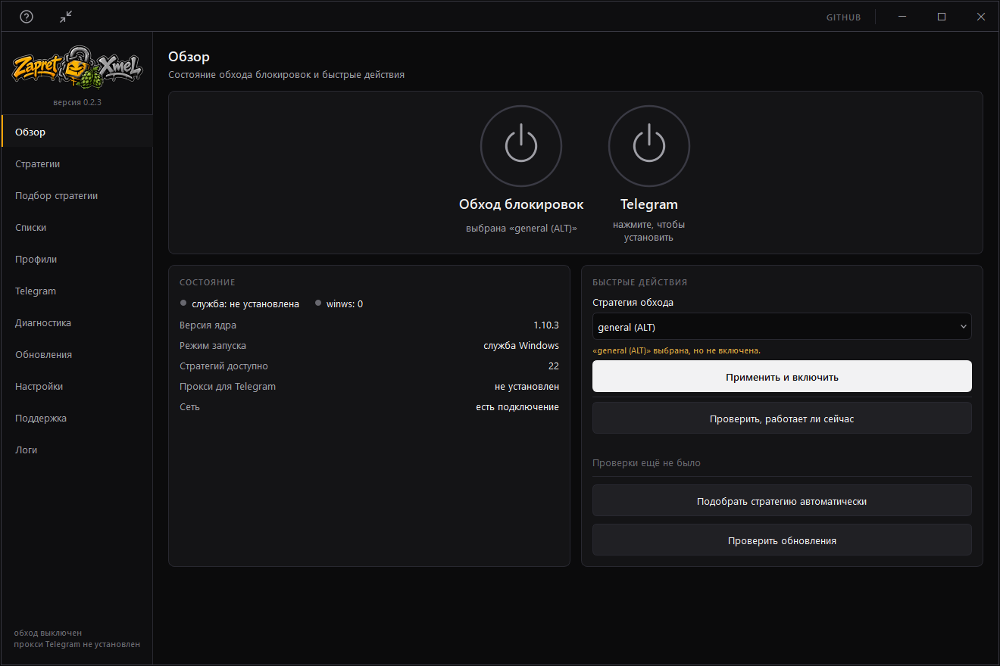
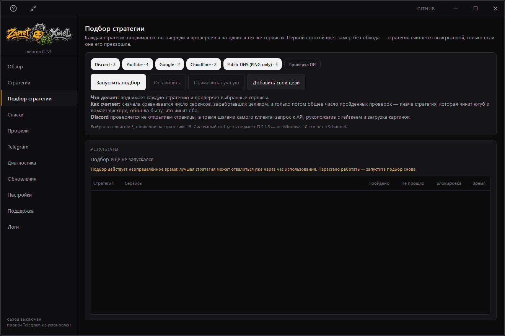
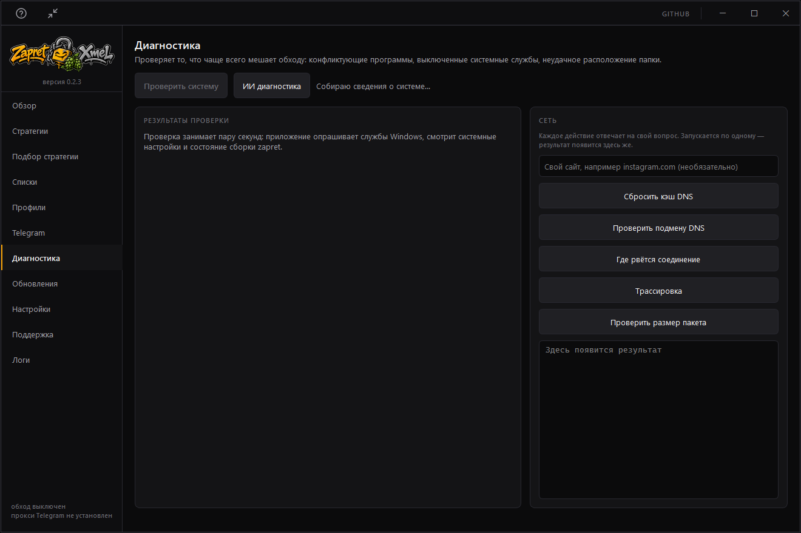
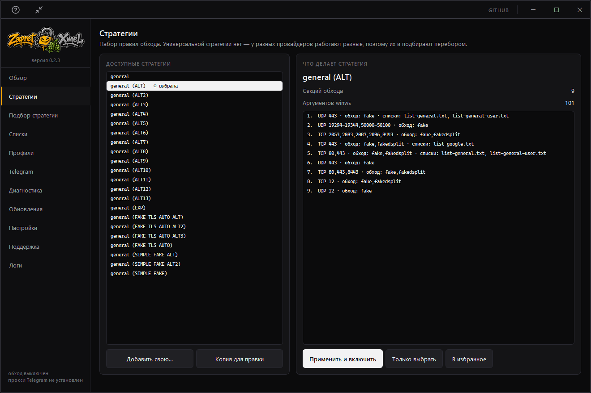
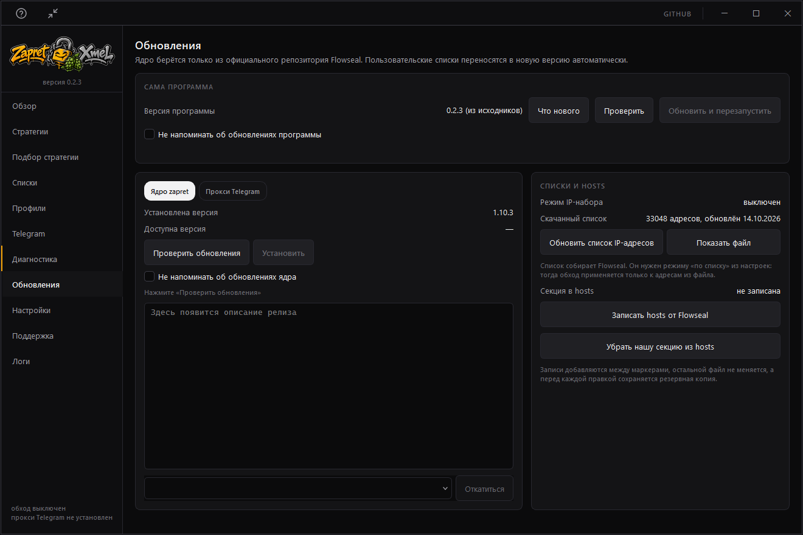

<div align="center">
  

  <p>
    <strong>Графическая оболочка для
    <a href="https://github.com/bol-van/zapret">zapret</a> в
    <a href="https://github.com/Flowseal/zapret-discord-youtube">сборке Flowseal</a>:
    управление службой, подбор стратегии перебором с замером, локальный прокси для
    Telegram и сетевая диагностика. Компоненты программа ставит и обновляет сама.</strong>
  </p>

  <p>
    <a href="https://github.com/igorxmel/ZapretXmel/releases"><strong>Релизы</strong></a> ·
    <a href="CHANGELOG.md"><strong>Что менялось</strong></a>
  </p>

  <p>
    <!-- Живые бейджи рисуются заранее в .github/workflows/badges.yml и лежат
      готовыми картинками в ветке badges. Ссылаться прямо на сервис нельзя:
      картинки в README отдаёт не он, а camo.githubusercontent.com — прокси
      GitHub, который ходит на сторонний хост и кеширует результат. Сервис
      притормозил в неудачный момент — camo запомнил неудачу, и один бейдж
      висит битым, хотя по ссылке открывается прекрасно. Так ломались и
      shields («Unable to select next GitHub token from pool»), и badgen.
      Теперь camo ходит к самому GitHub, и ломаться в цепочке нечему.
      Пустых строк здесь быть не должно: в markdown пустая строка закрывает
      HTML-блок, <div> оборвался бы прямо посреди комментария, и всё, что
      ниже, из README пропало бы. -->
    <a href="https://github.com/igorxmel/ZapretXmel/releases/latest"></a>
    <a href="https://github.com/igorxmel/ZapretXmel/stargazers"></a>
    <a href="https://github.com/igorxmel/ZapretXmel/releases"></a>
  </p>

  <p>
    
    
    
    <a href="LICENSE"></a>
  </p>
</div>

<details>
<summary><b>In English</b></summary>

**ZapretXmel** is a Windows GUI for [zapret](https://github.com/bol-van/zapret), a tool that
modifies network packets so that deep packet inspection (DPI) systems do not recognise them.
It wraps [Flowseal's bundle](https://github.com/Flowseal/zapret-discord-youtube), installs and
updates it, and evaluates its configurations ("strategies") one by one.

What it adds on top of the bundle: a strategy test that always measures the baseline first,
per-application profiles, a local MTProto proxy for the Telegram client, layered diagnostics
that show *where* a connection breaks (DNS, TCP, TLS or an ISP stub page) with an optional
AI pass, a watchdog that notices when a strategy stops working, and an uninstaller that
removes the service and the kernel driver.

The interface is in Russian only. [Releases](https://github.com/igorxmel/ZapretXmel/releases)
(Windows 10/11, 64-bit, no installer).

</details>

<div align="center">
  <!-- Снимки следуют теме GitHub: тёмное окно на светлой странице выглядит
    чужим, а светлое на тёмной слепит. Светлый вариант лежит рядом с суффиксом
    «-light», оба делает tools/readme_shots.py одним проходом. В src остаётся
    тёмный — его покажут те читалки, что про <picture> не знают. -->
  <picture>
    <source media="(prefers-color-scheme: light)" srcset="media/dashboard-light.png">
    
  </picture>
  <p><sub>Главный экран</sub></p>
</div>

##  Возможности

**Запуск.** Одна кнопка: службой Windows или обычным процессом, плюс значок в трее.
Стратегии проверяются перебором по всем сервисам сразу, с замером без них. Отдельную игру
или клиент можно вынести в свой профиль, и несколько профилей работают одновременно.
Для Telegram есть локальный MTProto-прокси: программа ставит его сама.

**Диагностика.** Проверки системы по правилам, а сверх них — на каком уровне рвётся
соединение: подмена DNS, обрыв по адресу, фильтрация по имени сайта или заглушка
провайдера. Дальше по желанию — разбор нейросетью или выгрузка пакета в любой чат-бот
руками. Сторож замечает, что стратегия перестала работать, и может переключиться на запасную.

**Настройка.** Копия готовой стратегии под своим именем, сборка новой из частей нескольких,
свои списки и свои цели проверок. Обновление ядра ничего из этого не теряет: бэкап, откат и
перенос пользовательских файлов.

**Интерфейс.** Мини-окно с двумя кнопками, выбором стратегии и проверкой, а всё остальное
в одном меню. Справка внутри программы, без сети. Светлая и тёмная тема — по умолчанию как в
Windows, переключается без перезапуска. Два оформления значка в трее. Удаление за собой:
служба, драйвер WinDivert и ядро убираются из самой программы, потому что установщика у неё
нет и из «Программ и компонентов» её не вычистить.

<details>
<summary><b>Ещё экраны</b> — подбор стратегии, диагностика, стратегии, обновления</summary>

<div align="center">
  <picture>
    <source media="(prefers-color-scheme: light)" srcset="media/autopick-light.png">
    
  </picture>
  <p><sub>Подбор перебирает стратегии по всем сервисам сразу и начинает с базового замера</sub></p>
  <picture>
    <source media="(prefers-color-scheme: light)" srcset="media/diagnostics-light.png">
    
  </picture>
  <p><sub>Диагностика: проверки системы по правилам, сетевые проверки и разбор нейросетью</sub></p>
  <picture>
    <source media="(prefers-color-scheme: light)" srcset="media/strategies-light.png">
    
  </picture>
  <p><sub>Стратегии: что именно делает выбранная — по секциям</sub></p>
  <picture>
    <source media="(prefers-color-scheme: light)" srcset="media/updates-light.png">
    
  </picture>
  <p><sub>Обновления: ядро, прокси для Telegram и сама программа</sub></p>
</div>

</details>

##  Установка

В [последнем релизе](https://github.com/igorxmel/ZapretXmel/releases/latest) два варианта:

- **`ZapretXmel-Windows-Setup.exe`** — установщик. Ставит программу в Program Files, делает
  ярлыки, и удалить её потом можно из «Приложений» Windows вместе со службой и драйвером.
  Запускается заметно быстрее переносной.
- **`ZapretXmel-Windows-Portable.exe`** — переносная, один файл. Положите его в отдельную
  папку — рядом появятся ядро и настройки — и запустите.

Права администратора программа запросит сама. `ZapretXmel.exe` в релизе — та же переносная
под прежним именем: по нему обновляются старые версии.

> [!WARNING]
> **Только из официальных источников.** У проекта нет и не будет отдельного сайта: всё
> находится в этом репозитории, а программа выкладывается только на [странице
> релизов](https://github.com/igorxmel/ZapretXmel/releases/latest). Сайт, который называет себя
> официальным, — подделка.
> Программа просит права администратора и загружает драйвер в ядро Windows,
> поэтому перезалив с файлопомойки или из чужого телеграм-канала — отличное
> место, чтобы спрятать что угодно. Проверить скачанное можно хешем, он ниже.

Ядро zapret внутрь не вшито: при первом запуске оно скачивается из официальных релизов
Flowseal. Так вы всегда получаете актуальную сборку, а не ту, что была на момент нашей.

Обновляется программа сама — в разделе «Обновления».

### Проверка файла

Рядом с каждым `.exe` в релизе лежит файл с тем же именем и `.sha256` на конце. Сверить
скачанное можно так:

```powershell
certutil -hashfile ZapretXmel-Windows-Setup.exe SHA256
```

Программа проверяет этот хеш и сама: всё, что она скачивает — ядро, прокси и новую
версию себя, — сверяется с хешем, который GitHub публикует рядом с файлом. Не совпало —
обновление не ставится.

### Антивирусы

> [!NOTE]
> Ложное срабатывание на оболочки над zapret — обычное дело, и эта не
> исключение. Это не значит, что всё в порядке по умолчанию: ниже написано,
> как убедиться самому.

Программа собрана PyInstaller в один файл, просит права администратора и загружает
драйвер WinDivert. Для антивируса это набор подозрительных признаков, поэтому ложное
срабатывание — обычное дело для всех оболочек над zapret, не только этой.

Что с этим делать: сверьте хеш (см. выше), посмотрите [исходники](https://github.com/igorxmel/ZapretXmel)
и, если доверяете, добавьте папку программы в исключения. Антивирус, удаливший
`WinDivert64.sys`, ломает работу программы — диагностика об этом скажет отдельной строкой.

##  Что уходит нейросети

> [!IMPORTANT]
> Снимок уходит наружу, поэтому из него вычищаются **имя пользователя** — в
> том числе внутри путей — и **публичные IP-адреса**. Ничего не отправляется,
> пока вы сами не подключите нейросеть и не нажмёте разбор.

Разбор нейросетью — дело добровольное: проверки по правилам работают всегда, без сети
и без ключей. Если разбор всё же нужен, уходит один и тот же снимок — его же можно
выгрузить файлом и отнести в любой чат-бот руками, ничего никуда не отправляя.

В снимке: версия Windows, версия ядра и число стратегий, состояние службы и драйвера,
аргументы запущенного winws, настройки сборки, найденные конфликтующие программы,
результат последнего подбора и хвост журнала. Перед отправкой из него вычищаются
**имя пользователя** (в том числе внутри путей) и **публичные IP-адреса** — то, по чему
вас можно опознать. Локальные адреса вроде `192.168.1.1` остаются: без них диагностика
теряет смысл, а узнать по ним никого нельзя.

Ключ доступа к нейросети хранится в DPAPI — хранилище Windows, привязанном к учётной
записи. В файл настроек он не попадает, потому что тот лежит рядом с программой и
уходит в бэкапы и диагностические пакеты.

##  Требования

- Windows 10 или 11, 64 бита.
- Права администратора: без них недоступны служба и драйвер WinDivert.

##  Что внутри

| Часть | Откуда |
|---|---|
| Ядро | [bol-van/zapret](https://github.com/bol-van/zapret) в сборке [Flowseal](https://github.com/Flowseal/zapret-discord-youtube) |
| Прокси для Telegram | [Flowseal/tg-ws-proxy](https://github.com/Flowseal/tg-ws-proxy) |
| Хосты для проверки DPI | [hyperion-cs/dpi-checkers](https://github.com/hyperion-cs/dpi-checkers) |

Ничего из этого не форкается и не вкладывается в репозиторий: всё скачивается из
официальных релизов и обновляется отдельно от программы. Полный список
компонентов и их лицензий — в [THIRD-PARTY.md](THIRD-PARTY.md).

Сама программа под [GPLv3](LICENSE). Выбор не идейный, а вынужденный: интерфейс
написан на PyQt6, а он выпускается под GPLv3 либо по платной коммерческой
лицензии, и собранный одним файлом `.exe` содержит его внутри.

##  Чем отличается подбор стратегии

Обычная проверка «открылась ли страница» у многих провайдеров проходит и без zapret, и тогда
«лучшей» становится стратегия, которая просто ничего не сломала. Поэтому здесь:

- **первым делом идёт замер без стратегии**: это точка отсчёта, и стратегия считается
  выигрышной, только если её превзошла;
- **счёт ведётся по сервисам**, а не общей суммой проверок;
- **Discord проверяется тремя шагами самого клиента**: запрос к API, рукопожатие
  с гейтвеем, загрузка картинок. Его страница открывается и когда клиент не работает;
- если победитель прошёл не все проверки, **об этом говорится прямо**;
- **активный VPN распознаётся** и подбор не запускается: через туннель замерять нечего.

##  Разработка

```powershell
python -m venv .venv
.venv\Scripts\pip install -e ".[dev]"

.venv\Scripts\python -m app                   # запуск
.venv\Scripts\python -m pytest tests/ -q      # тесты
.venv\Scripts\python -m ruff check app/ tests/ tools/
.venv\Scripts\python tools/screenshot.py      # снимки экранов
.venv\Scripts\python tools/build_release.py   # сборка .exe
```

Сверка с апстримом — что изменилось в сборке Flowseal и чего интерфейс ещё не умеет:

```powershell
.venv\Scripts\python tools/upstream_sync.py
```

Устройство проекта и правила — в [AGENTS.md](AGENTS.md).

##  Как помочь

Pull request'ы открыты, и мелкие тоже — опечатка в тексте или кривая подсказка
в интерфейсе ничем не хуже новой возможности. Как собрать у себя, о чём помнить
в коде и как оформлять коммиты — в [CONTRIBUTING.md](CONTRIBUTING.md).

Нашли ошибку — заводите задачу. Если дело в работе zapret, приложите пакет
из раздела «Диагностика»: там состояние системы и логи, по ним видно больше, чем
по описанию. Про дыру в безопасности — не публично, а по
[SECURITY.md](SECURITY.md).

##  Благодарности

- [bol-van/zapret](https://github.com/bol-van/zapret) — ядро
- [Flowseal/zapret-discord-youtube](https://github.com/Flowseal/zapret-discord-youtube) — сборка и стратегии
- [hyperion-cs/dpi-checkers](https://github.com/hyperion-cs/dpi-checkers) — набор хостов для проверки DPI
- [Flowseal/tg-ws-proxy](https://github.com/Flowseal/tg-ws-proxy) — локальный прокси для Telegram
- [basil00/WinDivert](https://github.com/basil00/WinDivert) — перехват пакетов
- [Noktomezo/ZapretInteractive](https://github.com/Noktomezo/ZapretInteractive) и
  [medvedeff-true/Zapret-GUI](https://github.com/medvedeff-true/Zapret-GUI) — соседние
  оболочки, у которых было чему поучиться

##  Частые вопросы

Ответы собраны в [FAQ.md](FAQ.md). О чём там:

- [Что такое ZapretXmel?](FAQ.md#что-такое-zapretxmel)
- [Это VPN?](FAQ.md#это-vpn)
- [Программа включена, а сайт не открывается. Почему?](FAQ.md#программа-включена-а-сайт-не-открывается-почему)
- [Программа не открывается: курсор моргнул и всё](FAQ.md#программа-не-открывается-курсор-моргнул-и-всё)
