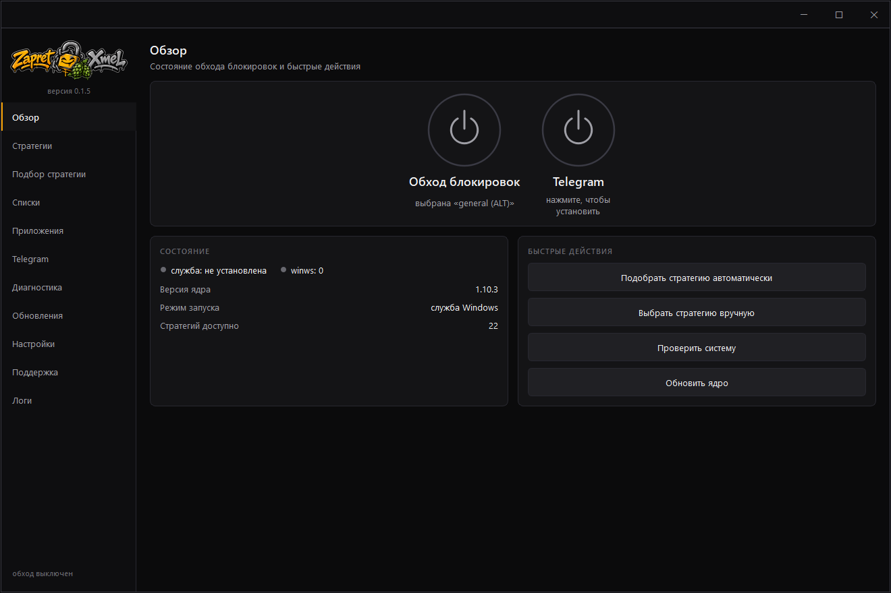
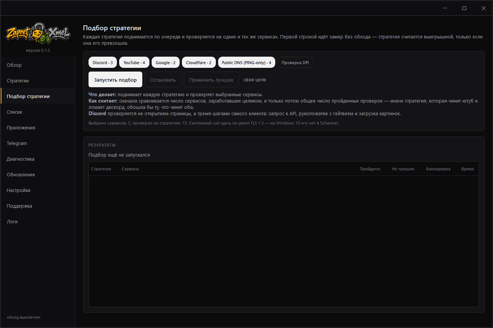
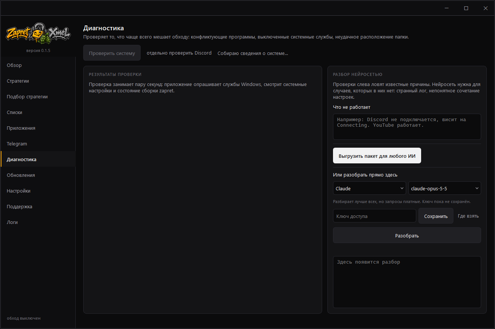
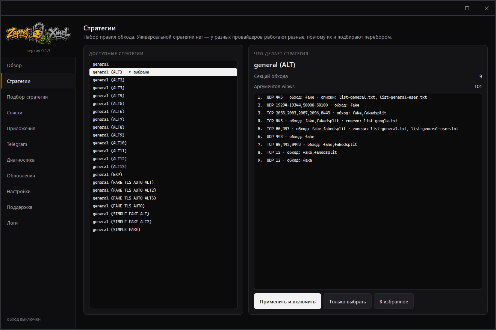
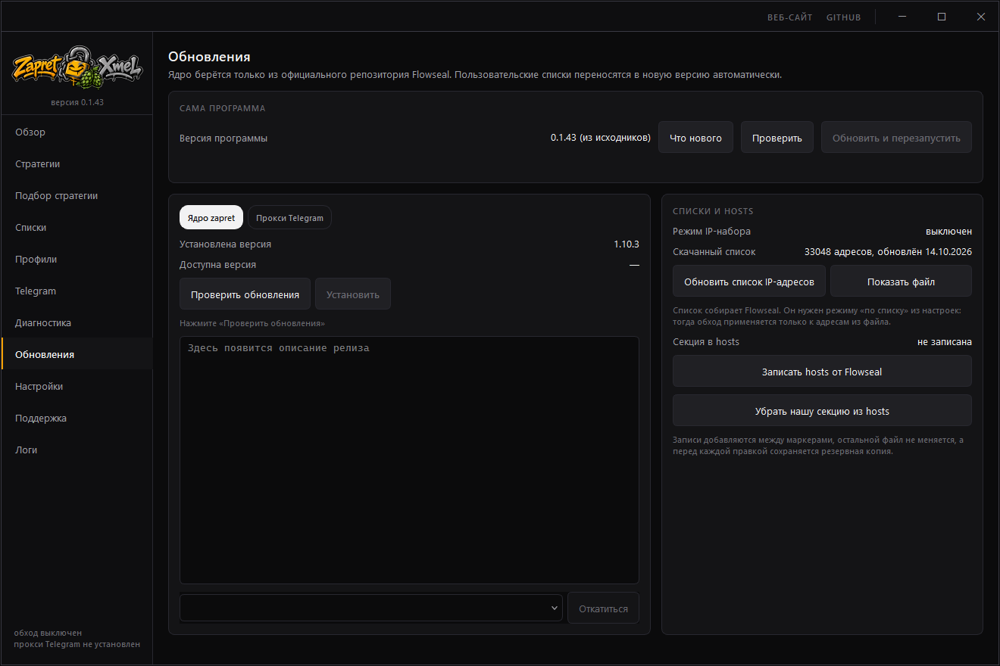

<div align="center">
  

  <p>
    <strong>Обход блокировок в одном окне: ядро
    <a href="https://github.com/Flowseal/zapret-discord-youtube">zapret в сборке Flowseal</a>,
    прокси для Telegram и подбор стратегии перебором. Чужие инструменты программа
    ставит и обновляет сама — разбираться с ними отдельно не нужно.</strong>
  </p>

  <p>
    <a href="https://igorxmel.github.io/ZapretXmel/"><strong>Страница проекта</strong></a> ·
    <a href="https://github.com/igorxmel/ZapretXmel/releases/latest"><strong>Скачать</strong></a> ·
    <a href="CHANGELOG.md"><strong>Что менялось</strong></a>
  </p>

  <p>
    <!--
      Живые счётчики берутся у badgen, а не у shields: shields ходит в API
      GitHub через пул токенов, общий на всех пользователей сервиса, и когда
      тот выбирает лимит, вместо числа показывается «Unable to select next
      GitHub token from pool». Бейджи ниже статичные — там API не нужен, и
      shields для них надёжен.
    -->
    <a href="https://github.com/igorxmel/ZapretXmel/releases/latest"></a>
    <a href="https://github.com/igorxmel/ZapretXmel/stargazers"></a>
    <a href="https://github.com/igorxmel/ZapretXmel/releases"></a>
  </p>

  <p>
    
    
    
    <a href="LICENSE"></a>
  </p>
</div>

<details>
<summary><b>In English</b></summary>

**ZapretXmel** is a Windows GUI for [zapret](https://github.com/bol-van/zapret) — a DPI
circumvention tool used in Russia to reach YouTube, Discord and other services that local
ISPs throttle or block. It wraps [Flowseal's bundle](https://github.com/Flowseal/zapret-discord-youtube),
installs and updates it for you, and finds a working strategy by trying them one by one.

What it adds on top of the bundle: an honest strategy picker (it always measures the
baseline **without** circumvention first, otherwise the "winner" is whatever didn't break
anything), per-application profiles, a local MTProto proxy for the Telegram client,
rule-based diagnostics with an optional AI pass, and a watchdog that notices when your
strategy stops working.

The interface is in Russian only — the problem it solves is specific to Russian ISPs, so
that is where its users are. [Download the latest release](https://github.com/igorxmel/ZapretXmel/releases/latest)
(Windows 10/11, 64-bit, no installer).

</details>

##  Возможности

- **Включение одной кнопкой** — службой Windows или обычным процессом, плюс значок в трее.
- **Подбор стратегии перебором** по всем сервисам сразу, с честным замером «без обхода».
- **Профили приложений** — пропустить через обход отдельную игру или клиент.
- **Telegram** через локальный MTProto-прокси: стратегии его не чинят, а это чинит.
- **Диагностика** по правилам плюс разбор нейросетью или выгрузка пакета для любого чат-бота.
- **Обновление ядра** с бэкапом и откатом; пользовательские списки переносятся сами.
- **Слежение за апстримом** — отчёт о том, чего интерфейс ещё не умеет.

<div align="center">
  
  <p><sub>Обход включается одной кнопкой · <a href="https://igorxmel.github.io/ZapretXmel/">все экраны на странице проекта</a></sub></p>
</div>

<details>
<summary><b>Ещё экраны</b> — подбор стратегии, диагностика, стратегии, обновления</summary>

<div align="center">
  
  <p><sub>Подбор перебирает стратегии по всем сервисам сразу и начинает с замера без обхода</sub></p>
  
  <p><sub>Диагностика: проверки системы по правилам и разбор нейросетью</sub></p>
  
  <p><sub>Стратегии: что именно делает выбранная — по секциям</sub></p>
  
  <p><sub>Обновления: ядро, прокси для Telegram и сама программа</sub></p>
</div>

</details>

##  Установка

1. Скачайте `ZapretXmel.exe` из [последнего релиза](https://github.com/igorxmel/ZapretXmel/releases/latest).
2. Положите его в отдельную папку — рядом появятся ядро и настройки.
3. Запустите. Права администратора программа запросит сама.

> [!WARNING]
> **Только из официальных источников.** Скачивайте программу со [страницы
> релизов](https://github.com/igorxmel/ZapretXmel/releases/latest) или с
> [сайта проекта](https://igorxmel.github.io/ZapretXmel/) — других нет.
> Программа просит права администратора и загружает драйвер в ядро Windows,
> поэтому перезалив с файлопомойки или из чужого телеграм-канала — отличное
> место, чтобы спрятать что угодно. Проверить скачанное можно хешем, он ниже.

Ядро zapret внутрь не вшито: при первом запуске оно скачивается из официальных релизов
Flowseal. Так вы всегда получаете актуальную сборку, а не ту, что была на момент нашей.

Обновляется программа сама — в разделе «Обновления».

### Проверка файла

Рядом с `.exe` в релизе лежит `ZapretXmel.exe.sha256`. Сверить скачанное можно так:

```powershell
certutil -hashfile ZapretXmel.exe SHA256
```

Программа проверяет этот хеш и сама: всё, что она скачивает — ядро, прокси и новую
версию себя, — сверяется с хешем, который GitHub публикует рядом с файлом. Не совпало —
обновление не ставится.

### Антивирусы

> [!NOTE]
> Ложное срабатывание на оболочки над zapret — обычное дело, и эта не
> исключение. Это не значит, что всё в порядке по умолчанию: ниже написано,
> как убедиться самому.

Программа собрана PyInstaller в один файл, просит права администратора и загружает
драйвер WinDivert. Для антивируса это набор подозрительных признаков, поэтому ложное
срабатывание — обычное дело для всех оболочек над zapret, не только этой.

Что с этим делать: сверьте хеш (см. выше), посмотрите [исходники](https://github.com/igorxmel/ZapretXmel)
и, если доверяете, добавьте папку программы в исключения. Антивирус, удаливший
`WinDivert64.sys`, ломает обход — диагностика об этом скажет отдельной строкой.

##  Что уходит нейросети

> [!IMPORTANT]
> Снимок уходит наружу, поэтому из него вычищаются **имя пользователя** — в
> том числе внутри путей — и **публичные IP-адреса**. Ничего не отправляется,
> пока вы сами не подключите нейросеть и не нажмёте разбор.

Разбор нейросетью — дело добровольное: проверки по правилам работают всегда, без сети
и без ключей. Если разбор всё же нужен, уходит один и тот же снимок — его же можно
выгрузить файлом и отнести в любой чат-бот руками, ничего никуда не отправляя.

В снимке: версия Windows, версия ядра и число стратегий, состояние службы и драйвера,
аргументы запущенного winws, настройки сборки, найденные конфликтующие программы,
результат последнего подбора и хвост журнала. Перед отправкой из него вычищаются
**имя пользователя** (в том числе внутри путей) и **публичные IP-адреса** — то, по чему
вас можно опознать. Локальные адреса вроде `192.168.1.1` остаются: без них диагностика
теряет смысл, а узнать по ним никого нельзя.

Ключ доступа к нейросети хранится в DPAPI — хранилище Windows, привязанном к учётной
записи. В файл настроек он не попадает, потому что тот лежит рядом с программой и
уходит в бэкапы и диагностические пакеты.

##  Требования

- Windows 10 или 11, 64 бита.
- Права администратора: без них недоступны служба и драйвер WinDivert.

##  Что внутри

| Часть | Откуда |
|---|---|
| Ядро обхода | [bol-van/zapret](https://github.com/bol-van/zapret) в сборке [Flowseal](https://github.com/Flowseal/zapret-discord-youtube) |
| Прокси для Telegram | [Flowseal/tg-ws-proxy](https://github.com/Flowseal/tg-ws-proxy) |
| Хосты для проверки DPI | [hyperion-cs/dpi-checkers](https://github.com/hyperion-cs/dpi-checkers) |

Ничего из этого не форкается и не вкладывается в репозиторий: всё скачивается из
официальных релизов и обновляется отдельно от программы.

##  Чем отличается подбор стратегии

Обычная проверка «открылась ли страница» у многих провайдеров проходит и без обхода —
и тогда «лучшей» становится стратегия, которая просто ничего не сломала. Поэтому здесь:

- **первым делом меряется, как всё работает без обхода** — это точка отсчёта,
  и стратегия считается выигрышной, только если её превзошла;
- **счёт ведётся по сервисам**, а не общей суммой: иначе стратегия, чинящая ютуб
  и ломающая дискорд, обходит ту, после которой работает и то, и другое;
- **Discord проверяется тремя шагами самого клиента** — запрос к API, рукопожатие
  с гейтвеем, загрузка картинок. Его страница открывается и когда клиент не работает;
- если победитель что-то так и не починил, **об этом говорится прямо**;
- **активный VPN распознаётся** и подбор не запускается: через туннель открывается
  всё подряд, и измерять там нечего.

##  Разработка

```powershell
python -m venv .venv
.venv\Scripts\pip install -e ".[dev]"

.venv\Scripts\python -m app                   # запуск
.venv\Scripts\python -m pytest tests/ -q      # тесты
.venv\Scripts\python -m ruff check app/ tests/ tools/
.venv\Scripts\python tools/screenshot.py      # снимки экранов
.venv\Scripts\python tools/build_release.py   # сборка .exe
```

Сверка с апстримом — что изменилось в сборке Flowseal и чего интерфейс ещё не умеет:

```powershell
.venv\Scripts\python tools/upstream_sync.py
```

Устройство проекта и правила — в [CLAUDE.md](CLAUDE.md).

##  Как помочь

Pull request'ы открыты, и мелкие тоже — опечатка в тексте или кривая подсказка
в интерфейсе ничем не хуже новой возможности.

Перед отправкой прогоните тесты и линтер — команды выше. Если правка меняет вид
окна, приложите снимок: `tools/screenshot.py` делает их все разом.

Две вещи, о которых стоит знать заранее, потому что они определяют почти все
решения в коде:

- **Ничего из того, что может измениться в сборке Flowseal, не зашивается в код.**
  Стратегии, флаги winws, списки, фейковые пакеты и цели проверок читаются с диска
  при запуске. Список известных стратегий в коде — это ошибка: он протухнет молча.
- **Измерения должны быть честными.** Любая проверка начинается с замера без обхода,
  а если победитель что-то не починил — об этом говорится прямо, а не прячется
  в общей сумме.

Нашли ошибку — заводите задачу. Если дело в неработающем обходе, приложите пакет
из раздела «Диагностика»: там состояние системы и логи, по ним видно больше, чем
по описанию.

##  Благодарности

- [bol-van/zapret](https://github.com/bol-van/zapret) — движок обхода
- [Flowseal/zapret-discord-youtube](https://github.com/Flowseal/zapret-discord-youtube) — сборка и стратегии
- [hyperion-cs/dpi-checkers](https://github.com/hyperion-cs/dpi-checkers) — набор хостов для проверки DPI
- [Flowseal/tg-ws-proxy](https://github.com/Flowseal/tg-ws-proxy) — прокси, который чинит Telegram
- [basil00/WinDivert](https://github.com/basil00/WinDivert) — перехват пакетов
- [Noktomezo/ZapretInteractive](https://github.com/Noktomezo/ZapretInteractive) и
  [medvedeff-true/Zapret-GUI](https://github.com/medvedeff-true/Zapret-GUI) — соседние
  оболочки, у которых было чему поучиться

##  Поддержка

Программа бесплатная и останется такой: обход блокировок — не та вещь, которую стоит
прятать за оплату.

Если она сэкономила вам вечер возни с батниками — расскажите о ней знакомым или
поставьте звезду репозиторию. Этого достаточно.
